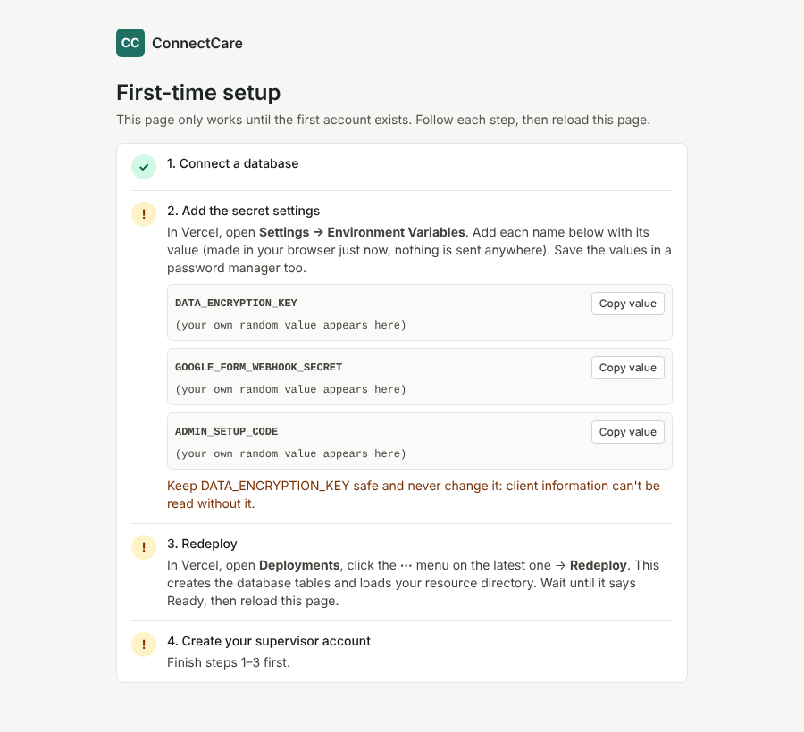

# Putting ConnectCare online for free (Vercel + Neon)

This guide gets your website running at **$0 a month**:

| Piece | Service | Cost |
|---|---|---|
| Website | **Vercel**, free "Hobby" plan | $0 |
| Database | **Neon**, free plan, added from inside Vercel | $0 |
| Intake form | **Google Forms**, with your Stanford Google account | $0 |
| AI assistant | Off for now (turn it on later with an Anthropic key) | $0 |

**Time:** about 45 minutes. You don't need to write any code.

> **Pilot with made-up people only.** The free plans don't include the agreements needed for real client health information (HIPAA). Use this to try everything with your team. Before entering real clients, see Part 8.

---

## Part 1: Create your Vercel account (5 minutes)

1. Go to **[vercel.com/signup](https://vercel.com/signup)**.
2. Choose **Hobby** (free) and click **Continue with GitHub**. Sign in with the GitHub account that owns the ConnectCare repository.

## Part 2: Import the project (5 minutes)

1. On the Vercel dashboard, click **Add New… → Project**.
2. Find **ConnectCare** in the list and click **Import**. If it isn't listed, click **Adjust GitHub App Permissions** and give Vercel access to that repository.
3. **Important:** next to **Root Directory**, click **Edit**, choose the **`case-management-platform`** folder, and click **Continue**.
4. Leave everything else as it is. The Framework should say **Next.js**.
5. Click **Deploy**. It takes 2–3 minutes. The first deploy works even though there's no database yet.
6. When you see "Congratulations", click **Continue to Dashboard**. Your website address is shown under **Domains**, something like **`connectcare-xyz.vercel.app`**. Write it down:

   `https://__________________________.vercel.app`

## Part 3: Open your website (1 minute)

Go to your website address. You'll see the **First-time setup** page. **Keep this tab open.** It shows a checklist and turns each step green as you finish it.

## Part 4: Add the free database (5 minutes)

1. In Vercel, open your project and click the **Storage** tab.
2. Click **Create Database**, choose **Neon** ("Serverless Postgres"), then click **Continue**.
3. Choose the **Free** plan. Pick the region closest to you, for example **US West (Oregon)**. Click **Continue / Create**, accepting Neon's terms if asked.
4. When it asks which project to connect, choose your ConnectCare project, keep all environments checked, and click **Connect**.

## Part 5: Add the secret settings (10 minutes)

1. Go back to your website's **First-time setup** tab and reload it. Step 2 now shows three names, each with a long random value:
   - `DATA_ENCRYPTION_KEY`
   - `GOOGLE_FORM_WEBHOOK_SECRET`
   - `ADMIN_SETUP_CODE`

   Your own browser made these values; they aren't sent anywhere. If you reload the page, new values appear. That's fine, but use all three from the *same* page.
2. **Save all three in a password manager** (or a private, secure note) before you continue.
3. In Vercel, open your project → **Settings** → **Environment Variables**. For each of the three:
   1. In **Key**, type the name exactly as shown, for example `DATA_ENCRYPTION_KEY`.
   2. In **Value**, paste the value from the setup page. Use **Copy value** to copy it.
   3. Leave all environments checked and click **Save**.

> Never change or lose `DATA_ENCRYPTION_KEY` after you start. It's what unlocks the client information.

## Part 6: Redeploy (5 minutes)

1. In Vercel, click the **Deployments** tab.
2. On the top deployment, click the **⋯** menu → **Redeploy** → **Redeploy**.
3. Wait until it says **Ready**, about 2–3 minutes. This creates the database tables and loads your 87 resources.
4. Reload the **First-time setup** tab. Steps 1–3 should now be green ✓.

## Part 7: Create your account and test (15 minutes)

**Your account**
1. On the setup page, step 4, enter:
   - the **setup code** (your `ADMIN_SETUP_CODE` value)
   - your name and work email
   - a password of at least 12 characters

   Then click **Create supervisor account**.
2. Sign in. Scan the QR code with an authenticator app on your phone (Google Authenticator, Microsoft Authenticator or Duo), then type the 6-digit code.
3. You're on the **Dashboard**. Click **Setup check** in the top menu to see what's working.

**Your team**
4. Click **Team** and add each case manager. Give each one their temporary password in person. They sign in and set up their own phone code.

**The Google Form**
5. Follow **[google-apps-script/README.md](google-apps-script/README.md)** (about 20 minutes). The two values it asks for are:
   - `CONNECTCARE_URL`: your website address, e.g. `https://connectcare-xyz.vercel.app`
   - `CONNECTCARE_SECRET`: your `GOOGLE_FORM_WEBHOOK_SECRET` value from Part 5

**Test with a made-up person**
6. Fill out the Google Form as "Test Person". It should appear on your Dashboard under **New requests**.
7. Assign it to a case manager in the **Intake queue**.
8. As that case manager: open it, add a note, click **Find resources & plan**, add a resource, and print the resource sheet.
9. As supervisor, delete the test client: open it → **Delete all data for this client**.

---

## Part 8: Before using it with real clients

The free setup is for the pilot. For real client information:

1. Ask **Stanford's Privacy Office** whether HIPAA applies to your program, and which hosting they approve.
2. If you stay on Vercel and Neon, you'd need their HIPAA agreements:
   - **Vercel Pro**: $20 a month, plus a $350 a month HIPAA add-on
   - **Neon Scale plan**: usage-based, with HIPAA available

   Or Stanford may host it for you on its own approved systems.
3. Go through the go-live checklist in **[PRIVACY.md](PRIVACY.md)**.

---

## Everyday tasks

| Task | How |
|---|---|
| Add or remove staff | **Team** page. Deactivate people the day they leave. |
| A case manager lost their phone | **Team** → **Reset 2FA** next to their name. |
| **You** lost your phone | Go to `your-site.vercel.app/recover` and enter your setup code and email. |
| Turn on the AI later | Get a key at console.anthropic.com. In Vercel → **Settings → Environment Variables**, add `ANTHROPIC_API_KEY`, then **Redeploy**. Test it on **Setup check**. |
| Fix a resource's phone or hours | **Resources** → open it → **Edit**. |
| Update the app after code changes | Merge the change on GitHub. Vercel redeploys automatically. |
| Something isn't working | Check **Setup check** first. Then in Vercel, open **Deployments** → latest → **Logs**, and send the red text to Claude. |

---

*Alternative host: `render.yaml` at the top of the repository sets everything up on Render (paid, about $13 a month) if you ever prefer it.*
