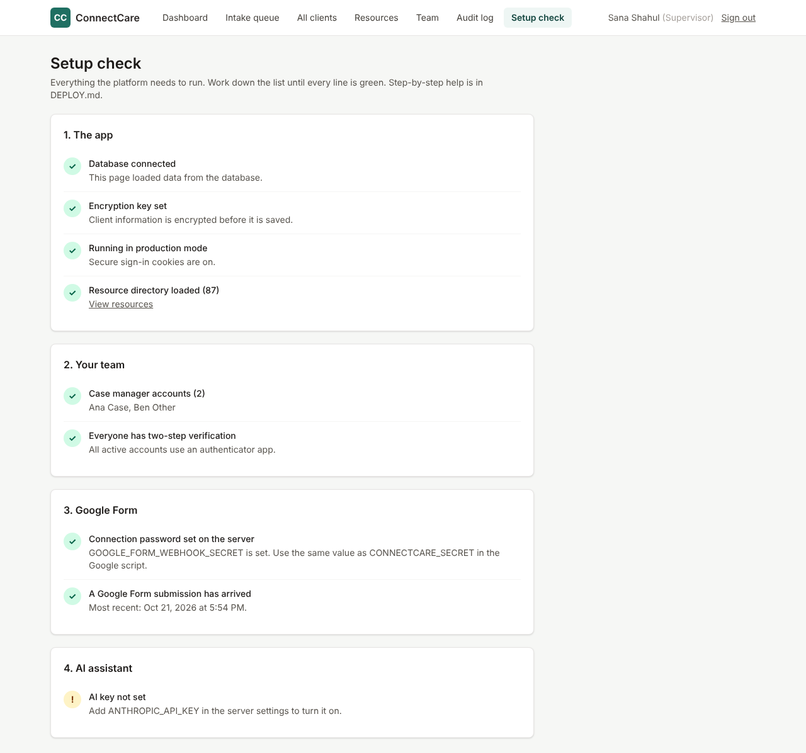

# Deploying ConnectCare, step by step

This guide takes you from "the code is on GitHub" to "my team is using it." Do the parts in order and check each box as you go. **Part 7** tells you how to confirm everything works before real clients use it.

**What you'll end up with**
- A website for your team, for example `https://connectcare.onrender.com`.
- A Google Form link to share with guests.
- New requests appearing on your dashboard, ready to assign.

**Time:** about 1 to 1.5 hours the first time.
**Cost:** about $13 a month on Render (web service about $7, database about $6), plus a few dollars of AI usage. Prices may change, so check render.com/pricing.

```
Guest fills out Google Form
        │  (signed, encrypted)
        ▼
ConnectCare website on Render  ──►  Postgres database (encrypted client data)
        │
        ▼
Supervisor dashboard → assign → Case manager → resources, AI plan, printout
```

---

## Part 0: Before you start (10 minutes)

You need four accounts. Create any you don't have yet.

- [ ] **GitHub**: you already have this. The code is in `sanashahul/connectcare`.
- [ ] **Render** ([render.com](https://render.com)): hosts the website and the database. Sign up with your GitHub account, then add a payment card.
- [ ] **Anthropic** ([console.anthropic.com](https://console.anthropic.com)): for the AI assistant. Create an account, add billing, then go to **API keys → Create key**. Copy the key (it starts with `sk-ant-`) and keep it somewhere private for Part 2.
- [ ] **Google Workspace**: use your organization's Google account (for example your Stanford account), not a personal Gmail.

> **Privacy note.** Until your privacy office approves the hosting (Render) and AI (Anthropic) accounts, test with **made-up people only**. Part 8 covers going live.

---

## Part 1: Get the code onto your default branch (5 minutes)

The new platform is currently on the branch `claude/practical-cray-wyqte8`. Render deploys from your repository's default branch, which is currently `claude/homeless-support-onboarding-8O111` (GitHub shows it first on the repository page).

- [ ] On GitHub, open the pull request from `claude/practical-cray-wyqte8` into the default branch and click **Merge pull request**.

---

## Part 2: Put the website online with Render (20 minutes)

The file `render.yaml` at the top of the repository tells Render everything it needs. Render creates the website and the database and generates the secret keys for you.

1. [ ] In Render, click **New +** → **Blueprint**.
2. [ ] Connect GitHub if Render asks, then choose the **connectcare** repository.
3. [ ] Render shows what it will create: a web service called **connectcare** and a database called **connectcare-db**. It asks for one value:
   - **ANTHROPIC_API_KEY**: paste the key from Part 0.
4. [ ] Click **Apply**. The first build takes about 5 to 10 minutes. During it, Render:
   - installs and builds the app,
   - creates the database tables,
   - loads the 87 resources from your guides,
   - starts the website.
5. [ ] When the **connectcare** service shows **Live**, click its address at the top of the page, for example `https://connectcare.onrender.com`. You should see the ConnectCare sign-in page.

**Write down your website address:** `https://________________________`

If the deploy fails, open the service's **Logs** tab and copy the last red lines into a message to Claude.

---

## Part 3: Create your supervisor account (5 minutes)

Nobody can sign up on their own; accounts are created by a supervisor. The very first one is created from Render's command line.

1. [ ] In Render, open the **connectcare** service and click **Shell** in the left menu.
2. [ ] Type this, with your own email and name, and press Enter:
   ```
   npm run create-supervisor -- --email you@stanford.edu --name "Your Name"
   ```
3. [ ] It prints a **temporary password**. Copy it.

---

## Part 4: Sign in and set up two-step verification (5 minutes)

1. [ ] On your phone, install an authenticator app: Google Authenticator, Microsoft Authenticator, Duo, or 1Password.
2. [ ] Go to your website address, enter your email and the temporary password.
3. [ ] The site shows a QR code. In the authenticator app, add an account and scan it. Then type the 6-digit code from the app into the site.
4. [ ] Choose your own password: at least 12 characters. A short sentence works well.
5. [ ] You land on the **Dashboard**. Click **Setup check** in the top menu. This page shows a green ✓ for each piece that works and an ! for what's left. Keep it open; you'll come back to it.

From now on, signing in takes your password plus the current code from your phone.

When everything is done, **Setup check** looks like this. The AI line turns green once the Anthropic key is set:



---

## Part 5: Add your case managers (10 minutes)

1. [ ] Click **Team**.
2. [ ] For each case manager, enter their name and work email, choose **Case manager**, and click **Create account**.
3. [ ] Each time, the page shows a **temporary password once**. Give it to them in person or by phone, not by email or text.
4. [ ] Each case manager does Part 4 on their own phone: sign in, scan the QR code, choose a password.

On **Setup check**, "Case manager accounts" turns green. "Everyone has two-step verification" turns green after each person has signed in once.

---

## Part 6: Connect the Google Form (20 minutes)

### 6a. Copy the connection password from Render
1. [ ] In Render, open **connectcare** → **Environment**.
2. [ ] Find **GOOGLE_FORM_WEBHOOK_SECRET**, click the eye icon to show it, and copy the value. This long password proves submissions really come from your form.

### 6b. Create the Google script
1. [ ] Signed in to your organization's Google account, go to [script.google.com](https://script.google.com) → **New project**. Rename it "ConnectCare intake" (click "Untitled project" at the top).
2. [ ] In the repository, open `case-management-platform/google-apps-script/Code.gs`, copy all of it, and paste it into the editor, replacing the sample code.
3. [ ] Click the **gear icon (Project Settings)** and check **Show "appsscript.json" manifest file in editor**.
4. [ ] Go back to the editor (`< >` icon) and click **appsscript.json**. Replace its contents with `case-management-platform/google-apps-script/appsscript.json`. Click **Save** (disk icon).
5. [ ] Go back to **Project Settings**, scroll to **Script properties**, and add two properties:

   | Property | Value |
   |---|---|
   | `CONNECTCARE_URL` | your website address from Part 2, e.g. `https://connectcare.onrender.com` (no slash at the end) |
   | `CONNECTCARE_SECRET` | the value you copied in 6a |

### 6c. Create the form
1. [ ] In the editor, choose **setup** from the function menu at the top, then click **Run**.
2. [ ] Google asks for permission. Click **Review permissions**, choose your account, and click **Allow**. If you see "Google hasn't verified this app", click **Advanced → Go to ConnectCare intake**. It's your own script, so this is expected.
3. [ ] The **Execution log** at the bottom shows two links:
   - **Share this link**: the form guests fill out. Copy it, and later put it on flyers as a QR code.
   - **Edit the form here**: change colors, add a logo, or adjust wording. Don't rename the questions.

**Write down your form link:** `https://docs.google.com/forms/________________________`

> Don't link the form to a Google Sheet, and don't turn on email notifications for new responses. The script deletes each response from Google once ConnectCare has saved it.

---

## Part 7: Test everything with a made-up person (15 minutes)

Do this before anyone real uses it. Use a made-up name and your own email.

**Guest side**
1. [ ] Open the form link on your phone. Fill it out as "Test Person", with your email, "Hope's Corner on Thursdays" as best place, "Need a shelter bed tonight and food" as urgent need, **Yes** for help today, and check consent. Submit.
2. [ ] Within a minute, you get an email "We received your request" with a number like **CC-7K3PM**.
3. [ ] In the Google Form editor, the **Responses** tab shows **0**, because the response was delivered and removed from Google.

**Supervisor side**
4. [ ] On the ConnectCare **Dashboard**, **New requests** shows the same CC number with "Google Form" and "Needs help today".
5. [ ] **Setup check** shows "A Google Form submission has arrived" in green.
6. [ ] On **Setup check**, click **Test AI connection**. It should say "Connected".
7. [ ] Open **Intake queue**, choose a case manager, and click **Assign**.

**Case manager side** (sign in as one of them, or ask them to)
8. [ ] The client appears on their **Dashboard** and in **My clients** by CC number.
9. [ ] Open it. The name, email, best place to reach, and urgent need are all there. Needs show Shelter and Food.
10. [ ] Add a note in the **Contact log** with a follow-up date.
11. [ ] Click **Find resources & plan**. Resources appear for each need. Click **+ Add to plan** on two of them.
12. [ ] On the same page, click **Draft a plan with AI**. Within about a minute, a plan appears. Anything outside your resource list is marked **Unverified**.
13. [ ] Click **Print resource sheet**. One page with the client ID, crisis numbers, and the resources in the plan.

**Privacy checks**
14. [ ] Sign in as a *different* case manager. The test client is **not** in their list.
15. [ ] As supervisor, open **Audit log**. You can see the sign-ins, views, and printout.
16. [ ] Open the test client as supervisor and use **Delete all data for this client** to remove the test person.

If every box is checked, the system works end to end.

---

## Part 8: Before real clients

Go through the **Go-live checklist in [PRIVACY.md](PRIVACY.md)** with Stanford's Privacy Office and Information Security Office. The main questions to bring them:

1. Is **Render** an approved place to host this data? If not, which host should we use? The app runs anywhere that supports Node.js and Postgres, so moving it is straightforward.
2. Is our **Anthropic** account covered by an approved agreement, such as a BAA? If not, set `AI_ENABLED` to `false` in Render → Environment until it is.
3. Is our **Google Workspace** account approved for this data in Google Forms?
4. Is the **consent wording** on the form acceptable?
5. How long should we **keep closed cases**?

---

## Everyday tasks

| Task | How |
|---|---|
| Add or remove a staff member | **Team** page. Deactivate people the day they leave. |
| Someone lost their phone | **Team** → **Reset 2FA** next to their name. They set it up again at next sign-in. |
| You (the supervisor) lost your phone | Render → connectcare → **Shell**: `npm run create-user -- --email you@stanford.edu --reset-2fa` |
| Turn off the AI | Render → connectcare → **Environment** → set `AI_ENABLED` to `false` → **Save**. |
| Update the app after code changes | Merge the change into the default branch on GitHub. Render redeploys automatically. |
| Fix a resource's phone or hours | **Resources** → open it → **Edit**. |
| Something isn't working | Open **Setup check** first. Then check Render → **Logs**, and the Google script → **Executions**. |

## Keep these safe

- **DATA_ENCRYPTION_KEY** (in Render → Environment). If it is lost or changed, the encrypted client information cannot be read. Copy it into your organization's password manager.
- **Your authenticator app.** Turn on its cloud backup, so a new phone doesn't lock you out.
