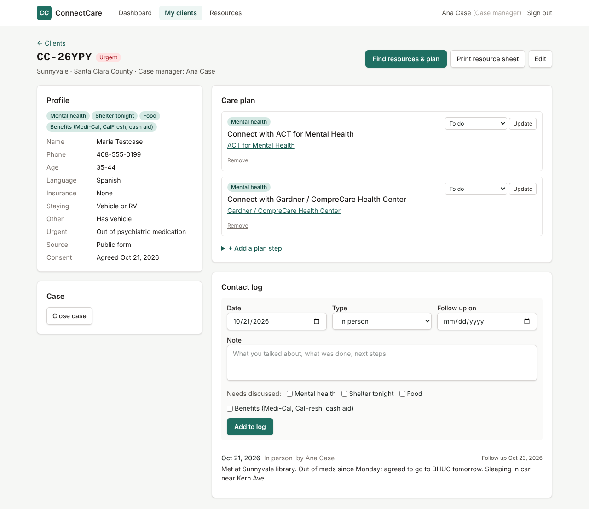

# ConnectCare Case Management

A web app for a street medicine team in Santa Clara and San Mateo counties. Unhoused guests fill out a request form; the team's case managers use the app to follow up and help each guest.

It does six things:

1. **Intake.** Guests ask for help through a **Google Form** or the app's own form at `/intake`, in **English, Spanish or Vietnamese**. Choice answers reach staff in English. Either way, the request goes straight into the app. Google Form setup: [google-apps-script/README.md](google-apps-script/README.md).
2. **Assignment.** New requests land in the supervisor's **Intake queue**. The supervisor assigns each guest to a case manager, and the whole record moves with them.
3. **Case work.** For each client, case managers keep a profile, a **contact log**, and a **care plan** (steps linked to resources, tracked as To do → Referred → Connected → Done). Each log entry is **Met with guest** (with where they were seen), **Couldn't find**, or **Update** (work done for them, like calling a shelter). Guests nobody has met in 14 days are flagged to their case manager and supervisors.
4. **Resources.** A searchable **directory** of 87 vetted resources built from the team's five guides. The app matches resources to each client's needs, area, language, and insurance, and lists the gaps it can't fill.
5. **Monthly report.** Supervisors get a one-page report per month with counts only (requests, time to first contact, top needs, plan steps connected or done, share of guests we couldn't find), downloadable as a PDF.
6. **AI help and printouts.** An optional **AI assistant** drafts a plan and suggests resources to fill gaps. Anything outside the vetted directory is marked **unverified** until a case manager checks it. A **one-page resource sheet** prints only what applies to the client.

**Clients are shown by name** to the staff who can see them. Every client also gets a short request number such as `CC-7K3PM`, which guests see after submitting the form and can mention when they contact the team. The audit log records IDs, never names.

Who sees what:

- **Case managers** see only the clients assigned to them.
- **Supervisors** see everyone. They also manage the team and the resource directory and can read the audit log.

Privacy is built in. Read [PRIVACY.md](PRIVACY.md) before using the app with real clients.



## Daily workflow

| Who | Where | What |
|---|---|---|
| Guest or volunteer | The Google Form or `/intake` (share the link or a QR code at outreach sites) | Fills out the request form. |
| Supervisor | **Team** → View their Home | Sees a case manager's Home exactly as they do, read-only, with a Message button for each client. |
| Supervisor | **Home** → New requests | Sees the newest requests by ID, with their source and most urgent need. |
| Supervisor | **Intake queue** | Sees new requests by client ID (urgent ones flagged) and each case manager's current caseload. Assigns each request. |
| Case manager | **Home** | **Task list**: one line per client, the top step of that client's Up next (in the order the case manager set). Overdue, due today and urgent come first, then guests not reached in 14 days and new guests. Then their clients grouped as Needs attention / New to you / On track, and a small **My own to-dos** box. |
| Case manager | Client → **At a glance** | The one next step, when they were last seen, and for new clients a 4-step **Getting started** checklist (first contact, confirm needs, add steps, print sheet). |
| Case manager | Client → **Care plan** | Buttons for **Up next**, **Waiting**, **Connected** and **Done**. Drag Up next steps (or use ↑ ↓) into the order you'll do them; the top one feeds the Task list. **Reset order** goes back to soonest due first. One button moves a step forward. |
| Case manager | Client → **Contact log** → Edit | Authors can correct their own entries; edited entries show "Edited" and the date. |
| Case manager | Client → **Contact log** | Logs **Met with guest** (and where), **Couldn't find**, or an **Update**, plus needs and a follow-up date. |
| Case manager | Client → **Find resources & plan** | Sees matched resources per need and the gaps. Adds resources to the plan. Optionally asks the AI for a draft plan. |
| Case manager | Client → **Print resource sheet** | Prints a one-page sheet for the client. It contains no last name, contact details, or notes. |
| Anyone on staff | **Resources** → Report a problem | Flags a wrong phone number or changed hours. |
| Supervisor | **Home** → Not reached in 14+ days | Sees guests nobody has met recently and who their case manager is. |
| Supervisor | **Reports** | Monthly program report for team check-ins and funders. **Download PDF** saves it. |
| Supervisor | **Resources** | Fixes reported problems and entries where the guides disagree. Marks resources as verified. |

## Deploying

**Start here: [DEPLOY.md](DEPLOY.md)** is a step-by-step guide to putting this online for free with Vercel and Neon. It covers your account, your team, the Google Form, and a test with a made-up person. Inside the app, supervisors can open **Setup check** to see what's working.

## Running it locally

You need Node.js 20+ and Postgres 16. `docker compose up -d` starts a local Postgres.

```bash
cd case-management-platform
npm install
cp .env.example .env
npm run generate-key          # paste the output into DATA_ENCRYPTION_KEY in .env
npm run db:migrate            # create tables
npm run db:seed-resources     # load data/resources.json (87 resources)
npm run create-supervisor -- --email you@example.org --name "Your Name"
npm run dev                   # http://localhost:3000
```

Sign in with the temporary password the script prints. You will set up two-step verification with an authenticator app and choose a new password. After that, add your case managers on the **Team** page.

**Lost phone.** A supervisor can reset another person's two-step verification on the Team page. If the supervisor loses theirs, run `npm run create-user -- --email them@example.org --reset-2fa` on the server.

## Checks

```bash
npm test          # unit tests: encryption, 2FA codes, access rules, redaction, matching, data shape
npm run typecheck
npm run build
```

## Updating resources

- **Day to day:** supervisors edit resources in the app. Saving marks an entry as verified today. Entries not verified in 90 days are flagged.
- **Where the guides disagree:** [data/RESOURCE_CONFLICTS.md](data/RESOURCE_CONFLICTS.md) lists every conflict, and the affected entries show a "Guides disagree: check" badge until a supervisor confirms them.
- **Bulk changes:** edit `data/resources.json` and deploy (or run `npm run db:seed-resources`). New entries are added, and entries nobody has edited in the app are refreshed from the file. Entries a supervisor edited, verified, or archived in the app are left alone. Use `-- --overwrite` to replace everything from the file.

## The AI assistant

The assistant is **on** as soon as `ANTHROPIC_API_KEY` is set in the server environment. Set `AI_ENABLED=false` to turn it off.

The assistant receives:

- the client's county, needs, age range, language, insurance and sleeping situation, and four yes/no flags;
- the public resource directory;
- an optional question, with names, phone numbers, emails, dates, and addresses removed.

It never receives names, client IDs, contact details, intake free text, or case notes. Staff can see the exact list of what is sent before they press the button. The assistant can search the web to fill gaps; set `AI_WEB_SEARCH=false` to prevent that.

## Deploying

Use a host your institution has approved for this kind of data. You need:

- **Database:** a managed Postgres with encryption at rest, automatic backups, and TLS (`?sslmode=require`).
- **App server:** any Node.js host that serves over HTTPS only.
- **Secrets:** `DATA_ENCRYPTION_KEY` (and `ANTHROPIC_API_KEY`, if the AI is on) kept in the host's secret manager, never in the repository.
- **Setup:** run `npm run build`, `npm run db:migrate`, then `npm start`.
- **One instance:** the login and form rate limits are kept in memory. If you run more than one instance, move them to a shared store.

## Project layout

```
src/app/(public)/      intake form, sign-in, two-step verification
src/app/(staff)/       dashboard, intake queue, clients, resources, team, audit log
src/lib/crypto.ts      AES-256-GCM field encryption
src/lib/session.ts     sessions (hashed tokens, idle timeout)
src/lib/totp.ts        authenticator-app codes (RFC 6238)
src/lib/access.ts      who can see which client
src/lib/resource-match.ts  matching clients to resources, gap detection
src/lib/ai.ts          AI planning assistant (de-identified input only)
src/db/schema.ts       database tables
data/resources.json    the resource directory, built from the five guides
```
