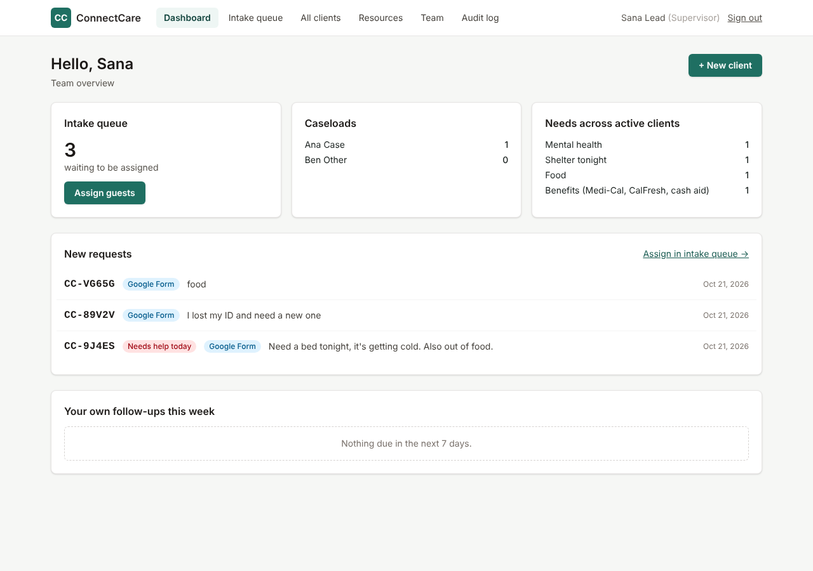

# Google Form intake: setup guide

This connects a Google Form to ConnectCare. Each time someone fills out the form:

1. The answers are sent to ConnectCare over an encrypted, signed connection.
2. ConnectCare creates a client with an ID (like `CC-9J4ES`). The request appears on the supervisor's **Dashboard** under **New requests** and in the **Intake queue**.
3. If the person gave an email, they receive their request number by email.
4. Once ConnectCare confirms it saved the request, the response is **deleted from Google Forms**. The information then lives only in the encrypted ConnectCare database.
5. If ConnectCare is unreachable, the response stays in Google, and the script tries again every 15 minutes.

From there, the supervisor assigns the request to a case manager, and the case manager continues as usual: contact log, resources, AI plan, printout.



## The form

The script creates the form for you, with these questions:

| Question | Required | Goes to |
|---|---|---|
| Your name | Yes | Client name |
| Your pronouns | No | Shown next to their name for staff |
| Email | No | Client email; the request number is emailed here |
| Best place or way to contact you | Yes | "Best place to reach" |
| Preferred language | No | Preferred language (choices plus "Other"); used to match resources in their language |
| What do you need most urgently? | Yes | "Most urgent need"; also used to fill in need categories automatically |
| Do you need help today? | No | "Yes" marks the request as urgent |
| What else can we help with? | No | Need categories |
| Would you like LGBTQ+ affirming care? | No | "Yes" adds LGBTQ+ affirming resources to their matches. Stored encrypted. |
| Do you have a disability, or need any accommodations? | No | Yes / No / Prefer not to say, on their profile. Stored encrypted. |
| If yes, what would help us support you? | No | "Accommodations" on their profile. Stored encrypted. |
| Which area are you in? | No | City and county, used for resource matching |
| Anything else you'd like us to know? | No | "Additional information" on their profile. Stored encrypted. |
| Consent | Yes | Consent date. Submissions without consent are refused. |

## One-time setup (about 15 minutes)

**Do this with a Google account approved for this data**, ideally your organization's Google Workspace (for example, Stanford's), not a personal Gmail account.

### 1. Create a shared secret

The secret is a long password that proves form submissions really come from your script. On the ConnectCare server, generate one:

```bash
npm run generate-key
```

Set the output as `GOOGLE_FORM_WEBHOOK_SECRET` in the server's environment, then restart the app. Until this is set, the app ignores Google Form submissions.

### 2. Create the script

1. Go to [script.google.com](https://script.google.com) and click **New project**. Name it "ConnectCare intake".
2. Delete the sample code, then paste in all of [`Code.gs`](Code.gs).
3. Click **Project Settings** (gear icon) and check **Show "appsscript.json" manifest file in editor**. Back in the editor, replace the contents of `appsscript.json` with [`appsscript.json`](appsscript.json).
4. In **Project Settings → Script properties**, add two properties:
   - `CONNECTCARE_URL`: your app's address, for example `https://connectcare.example.org`
   - `CONNECTCARE_SECRET`: the same value as `GOOGLE_FORM_WEBHOOK_SECRET` from step 1

### 3. Create the form

1. In the editor, choose the `setup` function from the menu at the top and click **Run**.
2. Approve the permissions. Google asks for permission to manage forms, connect to an external service, run triggers, and send email as you.
3. Open **Execution log**. It shows two links:
   - **Share this link** goes to the form people fill out. Put it on flyers as a QR code, or text it.
   - **Edit the form here** lets you change colors, a logo, or wording.

Running `setup` again is safe. It reuses the same form, resets the triggers, and adds any questions that newer versions of the script introduced (for example pronouns, preferred language, and LGBTQ+ care). Your existing questions and settings are kept.

### 4. Test it

Fill out the form yourself. Within a few seconds, the request should appear on the ConnectCare dashboard under **New requests**. In Google Forms, the **Responses** tab should show 0, because the response was delivered and deleted.

## Changing the form

- **Wording, colors, logo, help text:** change these freely in the form editor.
- **Question titles:** don't rename them. The script finds answers by title. If you must rename one, update the matching line in `Q` at the top of `Code.gs`.
- **Adding questions:** you can add questions, but their answers are not sent to ConnectCare unless the script and app are updated too.
- **"What else can we help with?" and "Which area are you in?":** the choices must match the app's list. Change both together.

## Settings in `Code.gs`

- `DELETE_AFTER_SEND = true`: deletes each response from Google after delivery. Leave this on.
- `SEND_CONFIRMATION_EMAIL = true`: emails the request number to people who give an email address.

## Privacy rules for the form

- **Don't link the form to a Google Sheet** (Responses → "Link to Sheets"). A Sheet would keep a permanent copy that the script does not delete.
- **Don't turn on Google Forms email notifications for new responses.** They would put client information in your inbox.
- **Keep access to the script and form limited.** Only people who manage the form should be editors.
- **Share the "Share this link" URL, never the edit link.**

## Troubleshooting

| What you see | What to do |
|---|---|
| Responses pile up in Google Forms and nothing appears in ConnectCare | In the script, open **Executions** and look at the error. **HTTP 401** means `CONNECTCARE_SECRET` does not match the server. **HTTP 404** means the server has no `GOOGLE_FORM_WEBHOOK_SECRET`. "Could not reach" means the URL is wrong or the app is down. |
| "Set the CONNECTCARE_URL script property…" | Add the script properties (step 2.4). The address must start with `https://`. |
| People outside your organization can't open the form | In the form, go to **Settings → Responses** and turn off "Restrict to users in [organization]". |
